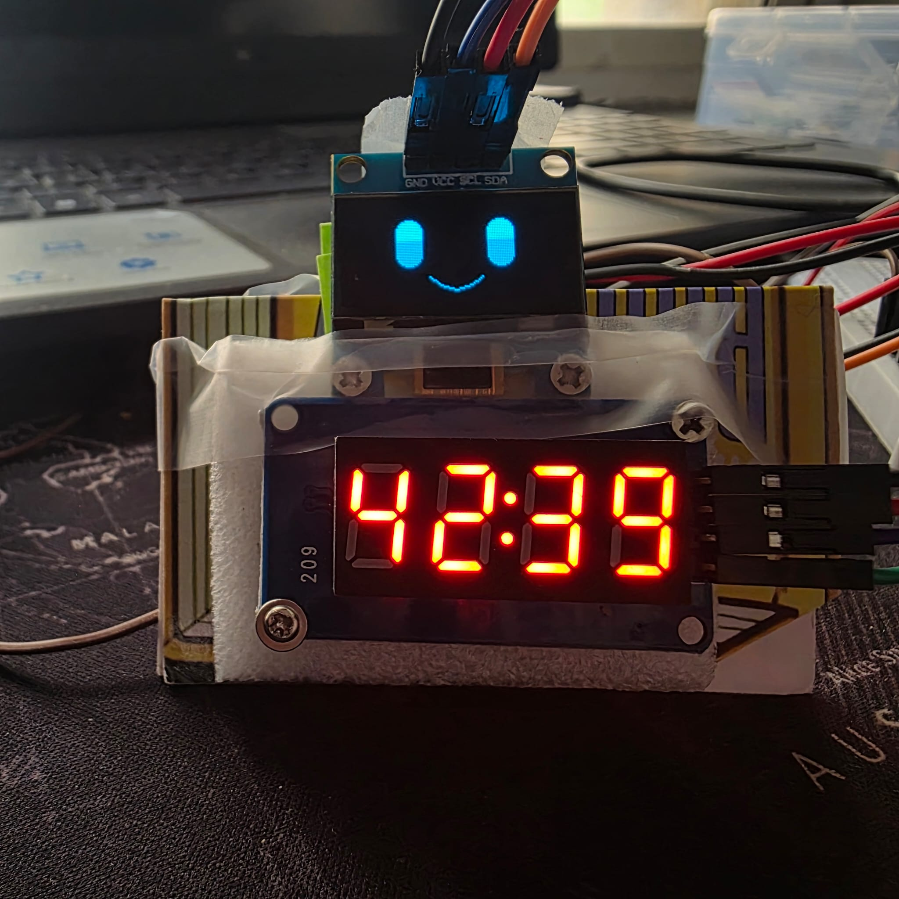
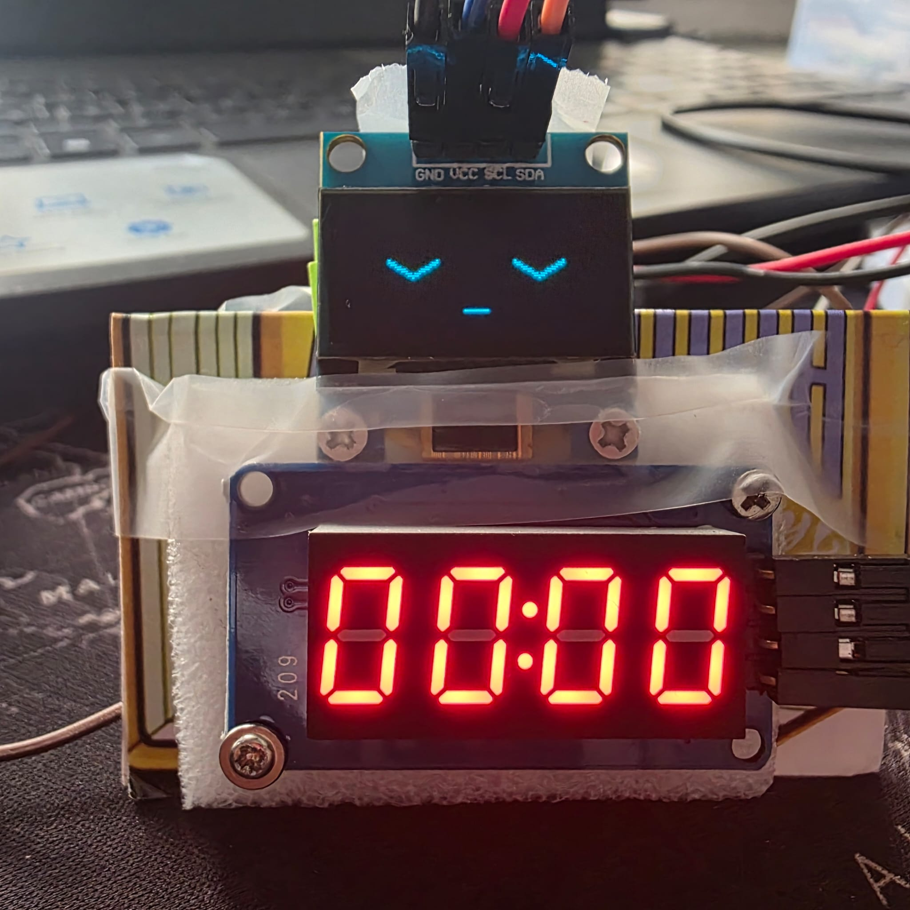

# 🤖 BUDDY — ESP32 Pomodoro Desk Companion

A tiny, expressive desk companion built using an **ESP32 DevKit**, a **0.96-inch OLED display**, and a **4-digit countdown timer**.

BUDDY makes focus sessions a little more fun with animated facial expressions, interactive button controls, and automatic sleep after each Pomodoro session.

## 📸 Project Demo

### Focus Session Running

### Focus Session Completed

## ✨ Features

- **25-minute and 45-minute focus modes**
- **Single-click** to change the selected duration
- **Double-click** to start a focus session
- Real-time countdown on a 4-digit LED display
- Animated OLED eyes, blinking, yawning, and sleeping
- Squishy giggle expression with blush lines
- Angry expression after six rapid button presses
- Automatic sleep when the countdown reaches `00:00`
- Manual restart after taking a break
- DHT11 temperature and humidity monitoring
- Temperature-dependent facial reactions

## 🛠️ Hardware

- ESP32 DevKit (ESP-WROOM-32)
- SSD1306 0.96-inch OLED display (128 × 64)
- TM1637 4-digit LED display
- DHT11 temperature and humidity sensor
- Push button
- Breadboard and jumper wires
- USB power supply or power bank

## 🔌 Pin Connections

| Component | ESP32 Pin |
|---|---|
| OLED SDA | GPIO 21 |
| OLED SCL | GPIO 22 |
| Push button | GPIO 18 |
| TM1637 CLK | GPIO 25 |
| TM1637 DIO | GPIO 26 |
| DHT11 DATA | GPIO 19 |

All modules share a common ground. Power connections must match each module's electrical specifications.

## 🍅 How It Works

**1. Select a session**

On startup, choose between 25 and 45 minutes using the push button.

**2. Start focusing**

Double-click the button. BUDDY wakes up, and the countdown begins.

**3. Interact with BUDDY**

During the session, BUDDY blinks and looks around. Button presses trigger cute giggling expressions. Repeated rapid presses make BUDDY angry temporarily.

**4. Finish your session**

At `00:00`, BUDDY yawns and returns to its sleeping expression. The timer remains at zero.

**5. Take a break**

After resting, press the button to start another session using the previously selected duration.

## 💻 Software Requirements

Arduino IDE with ESP32 board support.

Required libraries:

- Adafruit GFX Library
- Adafruit SSD1306
- TM1637Display by Avishay Orpaz
- DHT sensor library by Adafruit
- Adafruit Unified Sensor

## 🚀 Getting Started

1. Clone this repository.
2. Open `buddy.ino` in Arduino IDE.
3. Install the required libraries.
4. Connect the hardware according to the pin table.
5. Select **ESP32 Dev Module** and the correct COM port.
6. Upload the sketch.
7. Select a focus duration and double-click to begin.

## 🔮 Possible Future Improvements

- Buzzer alerts and melodies
- Automatic break timer
- Session statistics and daily focus tracking
- Wi-Fi dashboard
- 3D-printed enclosure
- Additional animated expressions

## 📌 Project Status

**Prototype / Work in Progress**

The firmware implements the Pomodoro countdown, facial animations, and environmental sensing. Hardware testing and refinements are ongoing.

---

Built as a hands-on exploration of embedded systems, microcontrollers, and interactive electronics.